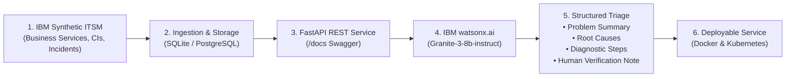

# ClientOps AI

> **Enterprise AIOps Platform powered by IBM watsonx.ai, IBM Granite Foundation Models, and Synthetic ITSM Data.**

[](https://python.org)
[](https://fastapi.tiangolo.com)
[](https://dataplatform.cloud.ibm.com)
[](https://www.docker.com)
[](https://kubernetes.io)

---

## 📌 Overview

**ClientOps AI** is a lightweight, production-grade AIOps platform that accelerates incident triage and root cause isolation for enterprise IT operations. It integrates:
1. **IBM's Synthetic ITSM Data Generator** from the official [IBM Enterprise ITSM Graph RAG](https://github.com/IBM/enterprise-itsm-graph-rag) repository to generate realistic multi-tier CMDBs, incidents, changes, problems, and knowledge articles.
2. **IBM watsonx.ai Granite Foundation Models** (`ibm/granite-3-8b-instruct`) for automated problem summarization, topological fault diagnosis, and remediation playbooks.
3. **Enterprise Python Backend (FastAPI)** exposing REST endpoints, live telemetry, and interactive Swagger documentation at `/docs`.
4. **Persistent Storage**: Zero-configuration SQLite for local development, switchable to PostgreSQL 16 for production.
5. **Interactive Operations Frontend**: A modern IBM Carbon-inspired web application featuring real-time KPI metrics, AI triage console, data ingestion validator, and live health monitoring.
6. **Container & Cloud Orchestration**: Multi-stage `Dockerfile`, `docker-compose.yml`, and Kubernetes (`k8s/`) manifests.

---

## 🏗️ Architecture & Progression Flow



---

## 🌟 Key Features

- **Official IBM ITSM Graph RAG Integration**: Generates coherent enterprise topologies (Business Services, CIs, Incident tickets, Problem Records, Change Requests, and KB Articles).
- **IBM Granite Inference**: Powered by `ibm/granite-3-8b-instruct`. Includes an intelligent fallback simulation mode so the demo runs seamlessly out of the box even before API credentials are configured.
- **Mandatory Human-in-the-Loop Verification**: Every AI output explicitly displays the compliance mandate:
  > *"CRITICAL NOTICE: AI-generated diagnostics and remediation recommendations are decision-support aids only and MUST be reviewed and validated by a certified human Systems Engineer, SRE, or Incident Commander before executing any command or production change."*
- **Enterprise REST API with Swagger**: Full OpenAPI schema available at `/docs` with endpoints for analysis, incident querying, synthetic generation, schema validation, and health checks.
- **Complete Interactive Frontend**:
  - **Dashboard**: Sidebar navigation, 4 real-time KPI cards, priority/state filtering, and sample incident picker.
  - **AI Incident Page**: Live triage interface submitting incidents to Granite with latency tracking and JSON export.
  - **Data Ingestion Page**: Drag-and-drop JSON/CSV validator with schema verification and direct 1-click synthetic generator.
  - **Live Monitoring Page**: Dynamic health checks and real-time round-trip API latency bar chart.

---

## 🚀 Quickstart Guide

### 1. Run the Standalone Progression Demo (CLI)
To observe the full pipeline from synthetic generation to database persistence, Granite analysis, and verification note:

```powershell
python run_demo.py
```

### 2. Launch the FastAPI Web Service & Frontend

```powershell
uvicorn app.api:app --host 0.0.0.0 --port 8000 --reload
```

Then open in your browser:
- **Interactive UI**: [http://localhost:8000/](http://localhost:8000/)
- **Swagger REST Docs**: [http://localhost:8000/docs](http://localhost:8000/docs)
- **Live Health Endpoint**: [http://localhost:8000/api/health](http://localhost:8000/api/health)

---

## 🔑 IBM watsonx.ai Configuration (Optional)

ClientOps AI works **100% out of the box** in offline-ready simulation mode. To connect directly to your live IBM Cloud watsonx.ai account:

1. Sign up for free access at [IBM watsonx.ai](https://dataplatform.cloud.ibm.com).
2. Generate an **IBM Cloud API Key** from [cloud.ibm.com](https://cloud.ibm.com).
3. Create a watsonx project and copy the **Project ID**.
4. Create a `.env` file from `.env.example`:

```env
WATSONX_API_KEY=your_ibm_cloud_api_key_here
WATSONX_PROJECT_ID=your_watsonx_project_id_here
WATSONX_URL=https://us-south.ml.cloud.ibm.com
GRANITE_MODEL_ID=ibm/granite-3-8b-instruct
```

Restart the service and the health check will automatically report `Mode: Live watsonx.ai Cloud Foundation Model`!

---

## 🐳 Enterprise Deployment: Docker & PostgreSQL

To deploy ClientOps AI with a dedicated PostgreSQL database container:

```bash
# Start PostgreSQL and ClientOps AI
docker-compose up --build -d

# Check status
docker-compose ps

# View application logs
docker-compose logs -f app
```

Access the service at [http://localhost:8000/](http://localhost:8000/).

---

## ☸️ Kubernetes Deployment

Deploy to any Kubernetes cluster (or Red Hat OpenShift):

```bash
# 1. Apply configuration and secrets
kubectl apply -f k8s/configmap.yaml
kubectl apply -f k8s/secret.yaml

# 2. Deploy the application with 2 replicas and rolling updates
kubectl apply -f k8s/deployment.yaml

# 3. Expose via LoadBalancer
kubectl apply -f k8s/service.yaml

# 4. Verify deployment
kubectl get pods -l app=clientops-ai
```

Before applying the secret manifest, replace its placeholder values with your watsonx.ai credentials and a strong PostgreSQL password.

---

## 📋 REST API Reference

| Method | Endpoint | Description |
| :--- | :--- | :--- |
| `POST` | `/api/analyze` | Triage an incident or raw log using IBM Granite |
| `GET` | `/api/incidents` | Query stored incidents with search, priority & state filters |
| `GET` | `/api/incidents/{id}` | Retrieve incident details and past AI analyses |
| `POST` | `/api/incidents` | Create a new IT incident ticket |
| `POST` | `/api/generate-synthetic`| Trigger IBM synthetic ITSM generator on demand |
| `POST` | `/api/import` | Upload & schema-validate synthetic JSON or CSV datasets |
| `GET` | `/api/kpis` | Live KPI telemetry (Total, Open, Critical, AI Coverage, MTTR) |
| `GET` | `/api/health` | System health check (API, Database, watsonx.ai) |
| `GET` | `/api/latency` | High-frequency latency probe for telemetry pinging |

---

## 🛡️ License & Attributions
- Built using components and schemas inspired by IBM's [enterprise-itsm-graph-rag](https://github.com/IBM/enterprise-itsm-graph-rag).
- Foundation Model: IBM Granite (`ibm/granite-3-8b-instruct`).
